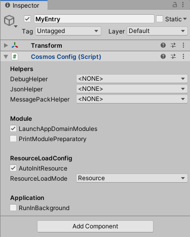

[](LICENSE)
[](https://github.com/DonnYep/CosmosFramework/issues)

# [中文](README.md) 

# CosmosFramework

CosmosFramework is a lightweight Unity development framework. It provides rich Unity method extensions and toolchain, async/await syntax support, multi-network channel support, and **pluggable resource loading** (Addressables / YooAsset / QuarkAsset, with an editor-only AssetDatabase fallback). The framework follows the unityPackage specification and is recommended to be imported through UPM.
* [CosmosFramework Wiki](https://github.com/DonnYep/CosmosFramework/wiki)<br/>

> **This version: the resource layer is rebuilt as a pluggable provider bridge.**
> The framework no longer ships its own resource management or packaging pipeline; solutions are plugged in through providers.
> Public APIs and call sites of UI, Entity, Audio, Scene, DataTable and ObjectsPool stay unchanged. See [Design Core](#design-core).

<a name="Navigation"></a>

# Navigation
- [中文](#中文)
- [CosmosFramework](#cosmosframework)
- [Navigation](#navigation)
  - [Environment](#environment)
  - [Launch CosmosFramework](#Launch-CosmosFramework)
  - [Design Core](#design-core)
  - [Module Introduction](#module-introduction)
  - [Built-in data structures,tools](#built-in-data-structurestools)
  - [Built-in Architecture PureMVC](#built-in-architecture-puremvc)
  - [Cautions](#cautions)
  - [UPM](#upm)
  - [Other](#other)
  - [Library link](#library-link)

- [ResourceModuleDocumentation](Docs/RESOURCE_EN.md)

<a name="Environment"></a>

## Environment

- Unity version:2018 and above,DOTNET API version:4.x.

<a name="Launch-CosmosFramework"></a>

## Launch CosmosFramework


- Add the CosmosConfig component to the game entry and add it to start the framework.

<a name="design-core"></a>

## Design Core

> **Resource loading is pluggable; every module's resource lifecycle is built on top of the Resource module; and the Resource module itself is built on top of a pluggable resource-management solution.**

That is one dependency-inversion chain: business modules know no resource library, only a contract; and the framework implements no resource management, only the bridge.

```text
┌───────────────────────────────────────────────────────────────────┐
│  UI · Audio · Entity · Scene · DataTable · ObjectsPool             │
│  depends on IResourceManager only, never on a resource library     │
└────────────────────────────────┬──────────────────────────────────┘
                                 │  key / handle / reference count
┌────────────────────────────────▼──────────────────────────────────┐
│  Resource module (bridge)                                          │
│  provider selection · ref counting · name index · scene registry   │
└────────────────────────────────┬──────────────────────────────────┘
                                 │  IResourceProvider (4 methods)
┌────────────────────────────────▼──────────────────────────────────┐
│  Addressables  │  YooAsset  │  QuarkAsset  │  AssetDatabase(Editor) │
└───────────────────────────────────────────────────────────────────┘
```

### 1. Pluggable loading solutions

The framework ships no resource management of its own — no AB build pipeline, no manifest format, no version verification.
It defines only a narrow provider contract (initialize, create one load operation, unload unused assets, destroy),
and adapters map each solution onto it.

| Solution | Assembly | Note |
| --- | --- | --- |
| Addressables | `Cosmos.Resource.Addressables` | most complete mapping, including `InstantiateAsync` pooling |
| YooAsset | `Cosmos.Resource.YooAsset` | `ResourcePackage` + `*OperationHandle` |
| QuarkAsset | `Cosmos.Resource.QuarkAsset` | natively name-keyed reference counting |
| AssetDatabase | `Cosmos.Resource.EditorFallback` | editor only, no build step, samples run out of the box |

Switching is a single provider name on `CosmosConfig`. Adapters use `versionDefines` + `defineConstraints`,
so an adapter assembly is simply not compiled when the corresponding package is absent.

### 2. Module lifecycles are built on the Resource module

UI, audio, entity, scene, data table and object pool never load assets themselves:

| Module | Loaded through the bridge | Released when |
| --- | --- | --- |
| UI | panel prefab | panel closes → `UnloadAsset` |
| Audio | `AudioClip` | audio unloaded → `UnloadAsset` |
| DataTable | table `TextAsset` | table unloaded → `UnloadAsset` |
| ObjectsPool | pool prefab | pool unloaded → `UnloadAsset` |
| Entity | entity prefab | stays resident, reclaimed on framework shutdown |
| Scene | scene | `UnloadSceneAsync`, or reclaimed by the bridge |

As a result: module code contains no `AssetBundle`, no `Addressables`, no `Resources.Load`, so
**switching solutions requires zero module changes**; reference counting, request coalescing,
scene registration and global cleanup live in exactly one place; and each module's public API
(`LoadPrefabAsync(name, callback, progress, instantiate)` etc.) stayed the same across the refactor.

### 3. The bridge is built on the pluggable solution

The bridge knows nothing about bundles, catalogs or packages. It handles two things only:
**key → handle** and **handle → reference count**. Solution-specific concepts (package name, manifest,
download, version, encryption) stay inside the provider; capability differences (sub assets, all assets,
instantiation, priority) are declared with capability flags, and the bridge reports a clear error instead
of letting a provider pretend to support something it does not.

```csharp
// Works with any provider
var handle = CosmosEntry.ResourceManager.LoadAssetHandle<GameObject>("Prefabs/Cube");
handle.Completed += h => Instantiate(h.Asset);
yield return handle;          // coroutine
var cube = await handle.Task; // async/await
handle.Release();             // reference count reaches zero → underlying asset unloaded
```

### 4. Runs without any third-party solution

An editor-only `AssetDatabase` fallback provider loads directly by asset name / path with no build step,
so samples and day-to-day editor work depend on no resource library at all; switch to
Addressables / YooAsset / QuarkAsset for device builds.

> Contract details, capability flags, diagnostics and how to write your own provider: [Resource module documentation](Docs/RESOURCE_EN.md).

<a name="Module-Introduction"></a>

## Module Introduction

- **Audio** : Game audio module. By registering audio information, you can automatically load audio resources to play by passing in the audio name when playing. audio effects support grouping, and the whole group can be played.

- **Config** : Game configuration module. The user can read the configuration file at game initialization and cache it in the configuration module. At runtime the data corresponding to the configuration is read at other desired locations.

- **Controller** : Controller module. By registering with this module, polling can be managed without generating a GameObject. This module provides update polling.

- **DataNode** : Data node module. The data is stored in this module in a tree structure, and the object corresponding to the data can be obtained by web address format or comma separator.

- **DataTable** : Data Table module. In this module, data rows are stored as objects in a data table. The data table can be added, deleted, and checked in real time, and the required data objects are generated by custom deserialization.

- **Download** : Download module. Support localhost local file download and http file download. Asynchronous incremental writing to localhost in byte stream when downloading files. Support for dynamic addition and removal of download tasks during downloading.

- **Entity** : Game Entity Module. Manage the game runtime entity objects. Entity support group classification, by passing in the resource address can directly manage the resource entity object generation, recycling and other operations, built-in object pool generation.

- **Event** : Event Center module. Using the standard event model, it provides common event functions such as listening, removing and dispatching. Provides event observation methods to detect event status in real time.

- **FSM** : Finite state machine module. Fully abstract finite state machines that can do state machine implementations for different types of owners.

- **Input** : Input adaptation module. The input of each platform is simulated by virtual keys, and different input adapters can be passed in to adapt the input methods of different platforms.

- **Main** : Module Center. Both custom modules and extensions are stored here. Custom modules are written in the same format as the built-in modules and have exactly the same lifecycle and permissions as the built-in modules. It is almost identical to the built-in module. The built-in polling pools of this main module: FixedRefreshHandler, LateRefreshHandler, RefreshHandler, ElapseRefreshHandler can poll the objects that need to be polled uniformly, reducing the performance loss caused by too many update and other mono callbacks. performance loss caused by too many update and other mono callbacks.

- **Network** : Network module. A variety of high-speed and reliable UDP protocols are provided, such as RUDP, SUDP, KCP, TCP, etc. The KCP protocol is used by default. Network in the form of channel (Channel) to distinguish each connection, support a variety of network types connected at the same time. Can be implemented (Client-Server) mode. Support async/await syntax.

- **ObjectsPool** : Object pool module. Provides commonly used functions such as entity object generation and recycling. The underlying implementation uses the data structure Pool.

- **Procedure**:Procedure node module. It is convenient to manage the logical nodes executed at runtime, such as hot game start node, resource check node, download resource node, enter game node, etc. Encapsulating each operation into a node greatly facilitates project maintenance.

- **Resource** : Resource module, the resource hub of the framework. Upwards it gives UI, Entity, Audio, Scene, DataTable and ObjectsPool one uniform way to load and release assets (reference counting, scene registry, diagnostics); downwards it plugs into any solution through `IResourceProvider` (Addressables / YooAsset / QuarkAsset / editor AssetDatabase). See [Design Core](#design-core) for the rationale and [Resource module documentation](Docs/RESOURCE_EN.md) for the contract.

- **Scene** : Scene module. Provide common asynchronous and synchronous loading of embedded scenes. Support custom implementation of loading methods.

- **UI** :  UI module.Abstract implementation of UI panels and the way UI is loaded. Support for activation, deactivation, panel priority, group settings and other functions , the use of more lightweight . Framework provides a panel based on the implementation of UGUI class and resource loading help body . Other UI programs can be extended by themselves , currently stable and compatible with FGUI.

- **WebRequest** : UnityWebRequest module, can be used to load persistent resources, network resources download and other needs. It supports getting AssetBundle, AudioClip, Texture2D, string, and when the resource is obtained, the user can operate on the resource through WebRequestCallback.


<a name="Built-in-data-structures,tools"></a>

## Built-in data structures,tools

- **Utility** : Provides common tool functions such as Reflection, Algorithm, Assertion, Conversion, Debug Rich Text, IO, Encryption, Json, MessagePack, Time, Text, Unity Coroutine, Unity Component, etc.

- **Singleton** : Singleton base class. Provides thread-safe, non-thread-safe, MONO singleton base classes.

- **DataStructure** : Common data structures. Data structures such as linked table, bidirectional linked table, bidirectional dictionary, binary tree, quadtree, AStar, LRU, thread lock, etc.

- **Extensions** : Static extension library. Provides Unity and C# native related extension methods.

- **Awaitable** : This tool provides support for async/await syntax in the unity environment. You can write asynchronous in Unity just like c# native asynchronous. Support Task asynchronous, Task execution will return to the main thread after completion, when using the normal format can be written.

- **EventCore** : Fully abstract event data structure. Contains normal, standard and thread-safe types.
```CSharp
    //Declare a class so that it derives from EventCore and does type constraints.
    public class MyEventCore :EventCore<string,string, MyEventCore>{}
    //Once implemented, you can use the custom event listener.
```
- **ReferencePool** : Global reference pool module.

- **Editor** : Editor provides methods to retrieve objects and components commonly used in Hierarchy, and EditorConfig provides the ability to automatically create code headers for code generation.

- **FutureTask**:Asynchronous task detection, supports multi-threaded and concurrent asynchronous progress detection. The detection function needs to be passed in Func<bool> format. Asynchronous detection ends when the condition return value is true. Support async/await syntax, you can use await statement to wait for the task to complete.

- **Pool**:Pool data structure. Includes thread-safe and non-thread-safe types. Object pools, reference pools and cache pools of other modules in the framework are implemented using "Pool".
    
<a name="Built-in-Architecture-PureMVC"></a>

## Built-in Architecture PureMVC

- A more understandable architecture based on the original PureMVC improvements.
    The framework provides a more concise feature-based registration:
    - 1.MVCCommandAttribute, corresponding to the Command, i.e. C layer.
    - 2.MVCMediatorAttribute, corresponding to the Mediator, i.e. the V layer.
    - 3.MVCProxyAttribute, corresponding to the Proxy, i.e. the M layer.
    
- The derived proxy class needs to override the constructor and pass in the NAME parameter.

- The derived proxy class needs to override the constructor and pass in the NAME parameter.

- Note that the MVC.RegisterAttributedMVC() method needs to be passed in the corresponding assembly. Multi-assembly reflection is supported.

<a name="Cautions"></a>

## Cautions

- Built-in case address:Assets\Examples\ .

<a name="UPM"></a>

## UPM 
- CosmosFramework follows the unityPackage specification and can completely place the entire library in the Packages directory.

- Import from local: Select the Assets/CosmosFramework folder and copy it to the project's Packages directory.

- Import from git: fill in the url: https://github.com/DonnYep/CosmosFramework.git#v1.3_upm

<a name="Other"></a>

## Other

- For a demonstration, please watch the video:
    - https://www.bilibili.com/video/BV11P4y1U7vB
    - https://www.bilibili.com/video/BV1x741157eR
    - https://www.bilibili.com/video/BV17u411Z7Ni
    
<a name="Library-link"></a>

## Library link

- HybridCLR:https://github.com/focus-creative-games/hybridclr

- CosmosEngine:https://github.com/DonnYep/CosmosEngine

- QuarkAsset:https://github.com/DonnYep/QuarkAsset

- KCP C:https://github.com/skywind3000/kcp
    
- KCP CSharp:https://github.com/vis2k/kcp2k
    
- TCP:https://github.com/vis2k/Telepathy

- Mirror:https://github.com/vis2k/Mirror

**[Back to top](#Navigation)**